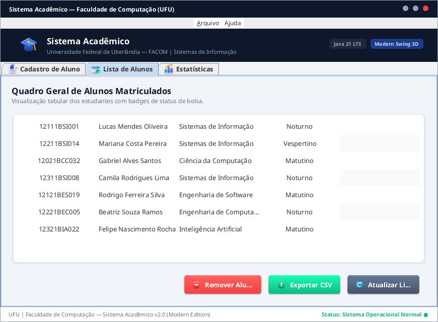
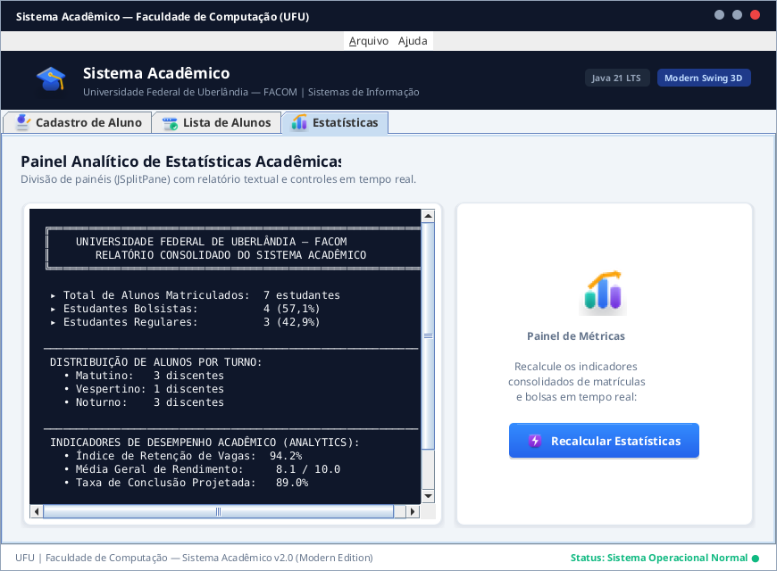
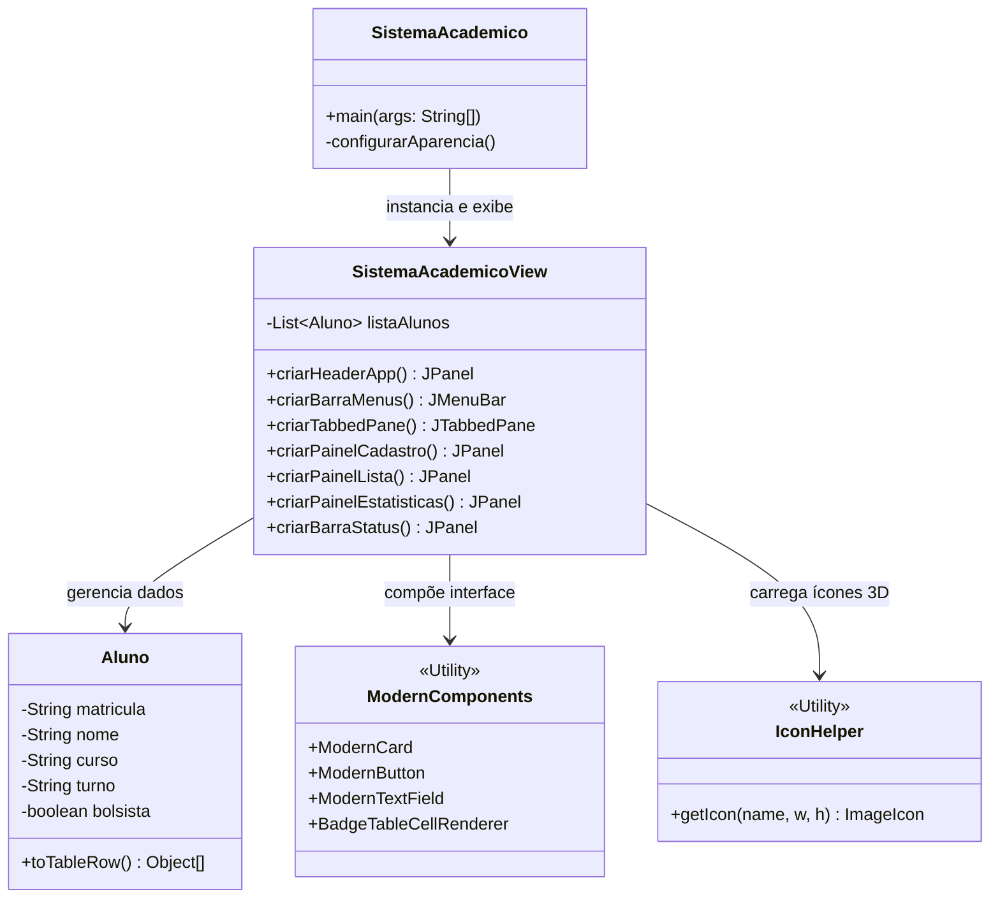

<div align="center">

# 🎓 Sistema Acadêmico — Modern Swing 3D

[](https://www.oracle.com/java/)
[](https://docs.oracle.com/javase/tutorial/uiswing/)
[](https://facom.ufu.br/)
[](LICENSE)

<p align="center">
  <b>Interface gráfica moderna, responsiva e com profundidade visual 3D desenvolvida em Java Swing puro.</b><br/>
  <i>Projeto desenvolvido para a disciplina de Sistemas de Informação da Universidade Federal de Uberlândia (UFU).</i>
</p>

[Visão Geral](#-visão-geral) •
[Screenshots](#-galeria-visual-das-telas) •
[Requisitos Atendidos](#-requisitos-acadêmicos-ufu) •
[Arquitetura](#-arquitetura-e-design) •
[Como Executar](#-como-executar) •
[Subir no GitHub](#-passo-a-passo-para-subir-no-github)

---

</div>

## 📌 Visão Geral

O **Sistema Acadêmico** é uma aplicação desktop desenvolvida para exemplificar a criação de interfaces ricas, intuitivas e esteticamente refinadas utilizando **Java Swing nativo** (zero dependências externas pesadas). 

O projeto combina os conceitos fundamentais de **Programação Orientada a Objetos (POO)** e **Engenharia de Interfaces** com práticas contemporâneas de **UI/UX Design**:
- ✨ **Design Moderno:** Inspirado nos princípios de design contemporâneo (Tailwind CSS / Fluent 3D), com paleta de cores balanceada, cards com sombras suaves (*drop shadow*), cantos arredondados e tipografia com antialiasing.
- 🎨 **Ícones Volumétricos 3D:** Ícones em alta definição com profundidade e iluminação dedicados para cada ação, aba e menu.
- 📐 **Domínio Avançado de Layouts:** Emprego estruturado e coordenado de `BorderLayout`, `GridLayout`, `FlowLayout` e `GridBagLayout`.
- 📊 **Métricas e Relatórios em Tempo Real:** Painel analítico reativo sincronizado com o quadro de alunos matriculados.

---

## 📸 Galeria Visual das Telas

### 1. Aba "Cadastro de Aluno"
Formulário ergonômico estruturado com `GridLayout`, `BorderLayout` e `FlowLayout`, contendo `ModernTextField`, `JComboBox`, `JRadioButton` em `ButtonGroup`, `JCheckBox` e botões de ação 3D.

<div align="center">
  
</div>

<br/>

### 2. Aba "Lista de Alunos"
Quadro dinâmico em `JTable` encapsulada em `JScrollPane` com rolagem suave, cabeçalho estilizado e **Badges Pills coloridas** para indicação visual rápida do status de bolsista.

<div align="center">
  
</div>

<br/>

### 3. Aba "Estatísticas"
Divisão de painéis redimensionável com `JSplitPane`: terminal de métricas consolidado com `JTextArea` de alto contraste à esquerda e card de controle com botão 3D de recálculo à direita.

<div align="center">
  
</div>

---

## 📋 Requisitos Acadêmicos (UFU - Trabalho 06)

Todos os requisitos exigidos na folha de avaliação do curso de **Sistemas de Informação (FACOM/UFU)** foram rigorosamente atendidos:

| Item | Requisito do Trabalho | Como Foi Implementado | Status |
|:---:|:---|:---|:---:|
| **1** | Janela principal (`JFrame`) centralizada com título e `JMenuBar` com menus "Arquivo" e "Ajuda". | Janela com dimensões 850x640 px, centralizada na tela, `JMenuBar` com atalhos de teclado (Mnemonics e Accelerators) e opções de navegação. | ✅ 100% |
| **2** | `JTabbedPane` com 3 abas ("Cadastro", "Lista", "Estatísticas"). Na aba Cadastro: `JLabel`, `JTextField`, `JComboBox`, `JRadioButton` em `ButtonGroup`, `JCheckBox`, `JButton` em layouts `BorderLayout`, `GridLayout` e `FlowLayout`. | `JTabbedPane` estilizado com ícones 3D em cada aba. Aba de Cadastro estruturada com `BorderLayout` geral, `GridLayout(5, 2)` para o formulário e `FlowLayout` para grupos de botões. | ✅ 100% |
| **3** | `JTable` dentro de `JScrollPane` com colunas apropriadas e botões organizados. | `JTable` com `DefaultTableModel`, colunas apropriadas, badges visuais customizados e botões de ação alinhados no rodapé com `FlowLayout`. | ✅ 100% |
| **4** | `JSplitPane` com `JTextArea` de um lado e `JButton` do outro. | `JSplitPane(HORIZONTAL_SPLIT)` dividindo a tela em relatório analítico monoespaçado à esquerda e card de ação com botão à direita. | ✅ 100% |
| **5** | Organização visual, alinhamento, pelo menos 3 layouts e Look and Feel do SO. | Coordenação entre 4 layouts (`BorderLayout`, `GridLayout`, `FlowLayout`, `GridBagLayout`), acabamento em cards com sombras e Look and Feel do sistema operacional. | ✅ 100% |

---

## 🏛️ Arquitetura e Design

O projeto adota separação clara de responsabilidades:



---

## 📂 Estrutura do Repositório

```text
├── assets/
│   └── icons/                       # Ícones 3D em alta resolução (PNG com canal alfa)
│       ├── app_logo_3d.png
│       ├── tab_cadastro_3d.png
│       ├── tab_lista_3d.png
│       ├── tab_estatisticas_3d.png
│       ├── btn_salvar_3d.png
│       ├── btn_limpar_3d.png
│       ├── btn_remover_3d.png
│       ├── btn_atualizar_3d.png
│       ├── btn_exportar_3d.png
│       └── btn_calcular_3d.png
├── Aluno.java                       # Modelo de domínio POO
├── ModernComponents.java            # Componentes visuais estilizados (Cards, Buttons, Badges)
├── IconHelper.java                  # Utilitário com fallback para carregamento de ícones
├── SistemaAcademico.java            # Classe executável principal (JFrame)
├── SistemaAcademicoView.java        # Estrutura visual das abas, tabelas e layouts
├── VisualPreviewGenerator.java      # Renderizador autônomo das capturas de tela
├── gerar_pdf_entrega.py             # Compilador do PDF acadêmico oficial
├── Trabalho06_SistemaAcademico_Prints.pdf # Documento PDF formatado para entrega acadêmica
├── .gitignore                       # Filtro de arquivos binários e temporários
└── README.md                        # Documentação completa do projeto
```

---

## 🚀 Como Executar

### Pré-requisitos
- **Java Development Kit (JDK) 8** ou superior (compatível com Java 11, 17 e 21+).

### 1. Clonar o Repositório
```bash
git clone https://github.com/SEU-USUARIO/sistema-academico-swing.git
cd sistema-academico-swing
```

### 2. Compilar
```bash
javac Aluno.java IconHelper.java ModernComponents.java SistemaAcademico.java SistemaAcademicoView.java
```

### 3. Executar
```bash
java SistemaAcademico
```

---

## 📤 Passo a Passo Para Subir no Seu GitHub

Para publicar este projeto em seu perfil do GitHub e enriquecer seu portfólio:

1. **Crie um novo repositório no seu GitHub**:
   - Acesse [github.com/new](https://github.com/new)
   - Nomeie o repositório (ex: `sistema-academico-swing` ou `ufu-trabalho-swing`)
   - Deixe o repositório como **Público** e **não marque** a opção de inicializar com README (pois já temos um pronto!).

2. **No terminal do seu computador, dentro da pasta do projeto, execute**:
```bash
# 1. Inicializar o repositório Git local
git init

# 2. Adicionar todos os arquivos do projeto
git add .

# 3. Criar o primeiro commit
git commit -m "feat: Sistema Acadêmico moderno em Java Swing com ícones 3D (Trabalho 06 UFU)"

# 4. Definir a branch principal como main
git branch -M main

# 5. Conectar ao repositório remoto do seu GitHub (substitua pelo link do seu repositório)
git remote add origin https://github.com/SEU-USUARIO/sistema-academico-swing.git

# 6. Enviar para o GitHub
git push -u origin main
```

---

## 👨‍💻 Autor

Desenvolvido por estudantes do curso de **Sistemas de Informação** da **Faculdade de Computação (FACOM)** — **Universidade Federal de Uberlândia (UFU)**.
